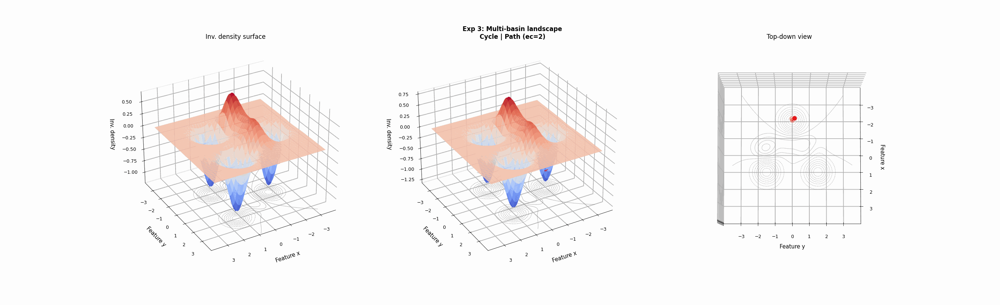

# Shaped by What's Missing: Topological Invariance Simplification Discovers Behavioral Transitions

Project page: <https://kbian.org/TopoMimic-website/>

Classical manifold learning methods (PCA, UMAP, t-SNE) learn a low-dimensional **embedding** of high-dimensional data. We take a different approach: instead of projecting to a coordinate space, we learn the **topological skeleton** of the data manifold itself. Each behavioral clip from a deep RL policy ([Mimic-mjx](https://mimic-mjx.talmolab.org/)) is a trajectory in a high-dimensional temporal space. We reconstruct the discrete Morse graph of this point cloud to extract two structural primitives:

- **DM Cycles (H₁)** — loops in the graph skeleton, capturing periodic or recurrent behavioral motifs.
- **DM Paths (H₀)** — edge-disjoint paths between persistent density minima, capturing transition corridors.

These sub-trajectories are the learned manifold coordinates. The natural metric on them is the **Wasserstein-2 distance**, which compares sub-trajectories as distributions rather than fixed-length vectors.


> Demonstration of discrete Morse cycles and paths in an inverse density space.

## Documentation

- [Intuition](docs/intuition.md) — conceptual overview of why topology helps.
- [Installation](docs/installation.md) — Python env, the C++ DM backend, and data access.
- [Running the pipeline](docs/running.md) — six stages end-to-end; one-line quick start.
- [Codebase structure](docs/codebase_structure.md) — directory map and module boundaries.
- [Methods](docs/methods.md) — method reference.
- [Demos](docs/demos.md) — illustrative examples.
- [Analysis README](topo_mimic/analysis/README.md) — per-block feature_analysis + method_analysis guide.
- [Transition mapping](docs/transition_mapping.md) — how cluster labels map to GT transitions.
- [Auto-labeling](docs/autoassign.md) — directional auto-label algorithm.

## Quick start

```bash
bash bash_scripts/run_all.sh
```

## Acknowledgements

- Adapted from the [MIMIC-MJX](https://mimic-mjx.talmolab.org/) package.
- DM-graph backend: [PCD-Graph-Recon-DM](https://github.com/lucasjmagee/PCD-Graph-Recon-DM/tree/main).
- Annotation tooling: [TopoMimic-annotation](https://github.com/KevinBian107/TopoMimic-annotation).

## Citation

```bibtex
@article{topomimic2026,
  title={Shaped by What's Missing: Topological Invariance
         Simplification Discovers Behavioral Transitions},
  author={Bian, Kaiwen and Leonardis, Eric J. and Yang, Yuanjia
          and Zhang, Charles and Azim, Eiman
          and {\"O}lveczky, Bence P. and Wang, Yusu
          and Pereira, Talmo D.},
  journal={arXiv preprint},
  year={2026}
}
```