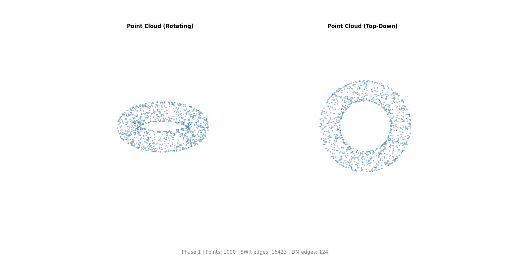

# Shaped by What’s Missing: Topological Discovery of Behavioral Transitions

## Manifold Learning through Discrete Morse Theory

Classical manifold learning methods (PCA, UMAP, t-SNE) learn a low-dimensional **embedding** of high-dimensional data. We take a different approach: instead of projecting to a coordinate space, we learn the **topological skeleton** of the data manifold itself.

Each behavioral clip from a deep RL policy ([Mimic-mjx](https://github.com/talmolab/Mimic-mjx)) is a trajectory in a high-dimensional temporal space (e.g. 500 frames × 16D = a point in R<sup>8000</sup>). We reconstruct the discrete Morse graph of this point cloud to extract two types of structural primitives:

- **DM Cycles (H₁)**: loops in the graph skeleton, capturing periodic or recurrent behavioral motifs
- **DM Paths (H₀)**: edge-disjoint paths between persistent density minima, capturing transition corridors

These sub-trajectories are the learned manifold coordinates — they represent the intrinsic structure (loops, branches, connectivity) rather than just pairwise proximity. The natural metric on this representation is the **Wasserstein-2 distance**, which compares sub-trajectories as distributions over the feature space rather than fixed-length vectors.

```
    R^(T × D)                    Topological skeleton                Metric space
 ┌──────────────┐             ┌─────────────────────┐           ┌──────────────────┐
 │ 500 × 16  (int)│   DM graph  │  Cycles (H₁ loops)  │  W₂ dist  │                  │
 │ 500 × 62 (qpos)│──────────►│  Paths  (H₀ bridges)│─────────►│  MDS + Clustering │
 │ 500 × 69  (ekp)│ reconstruction│  between density    │  between  │                  │
 └──────────────┘             │  minima             │  sub-traj └──────────────────┘
   high-dim input               manifold primitives             behavioral taxonomy
```

For intuition of this work, read [this page](/docs/intuition.md).


> Demonstration of discrete Morse traversal (cycle) on a torus.

## Environment Instantiation
We setup this repository similar to the [Mimic-mjx package](https://github.com/talmolab/track-mjx). All the `jax` dependency should be following the ones that is specified in `Mimic-mjx`. Besides the `Mimic-mjx` environment, we also need the [Stac-mjx package](https://github.com/talmolab/stac-mjx) for benchmarking (`Stac-mjx` should be installed prior to installing from `requirements.txt`, `KPMS` requires an newer version of jax dependency, which mismatch with `Stac-mjx` but workable).

Please also download some of the TDA related packages using the following:

```bash
pip install -r requirements.txt
```

We alsp uses the DM graph repo implemented in [this repository](https://github.com/lucasjmagee/PCD-Graph-Recon-DM/tree/main), which requires ths following compilation steps:

```bash
git clone https://github.com/lucasjmagee/PCD-Graph-Recon-DM.git

cd dmpcd/code/persistence_swr
g++ DiMoSC.cpp -I./phat/include -std=c++11 -o DiMoSC

cd dmpcd/code/phat_morse_src
g++ ComputeGraphReconstruction.cpp -std=c++11 -o ComputeGraphReconstruction
```

Use the following to check if the compilation is successful:

```bash
ls -lh dmpcd/code/persistence_swr/spt_cpp
ls -lh dmpcd/code/phat_morse_src/a.out
```

## Data & Notebook Access
The data used for this analysis can be generated by the `Mimic-mjx` package, this study can be reproduced from using `Stack-mjx` and `Mimic-mjx`. We provide the exact rollout dataset that we used for this study in [this drive for labeling](https://drive.google.com/file/d/1sYFkKQGJ0qTJGm0fEigXRn4dKGzGv7qQ/view?usp=drive_link) and [this drive for clustering](https://drive.google.com/file/d/1exMwbJbJAqhJdKvT6ez9POY-bFGYbemN/view?usp=sharing). You can use gdown to download. The labeling dataset was trained with tighter KL bound for better visualization purposes and the clustering dataset was trained with looser KL bound for easier clustering purposes.

## Annotation
We created this easy-to-use [annotation framework](https://github.com/ericleonardis/annotation-gui/) to annotate different animal behaviors using this [behavior lexicon](https://docs.google.com/document/d/19UC5Mu5mj_zmh2jDSHkML7WvMbdC4DbXrow3f1WBxC4/edit?usp=sharing). We have provided the [rendered videos here](https://drive.google.com/drive/folders/1tCw60UmBeP8hPDwPVnugsva0yIyO_mFU?usp=sharing). To retrieve all the videos, run the following:

```bash
python -m scripts.render_for_label configs/scripts/render_for_label.yaml
```

In addition, we can also identify the common transitions in the real data by running the following:

```bash
python -m scripts.analyze_transitions
```

## Running the Codebase

### Method & Codebase Structure
Refer to the [documentation folder](/docs/) for more detailed information on the method and codebase structure:
- [our methods](/docs/methods.md)
- [codebase structure](/docs/codebase_structure.md)
- [demos](/docs/demos.md)

### Quick Start (Bash Scripts)
Automation scripts run the main pipelines end-to-end across all feature spaces (intention, qpos, ekp):
```bash
bash bash_scripts/run_dm_pipeline.sh      # DM extraction + benchmark (all feature spaces)
bash bash_scripts/run_granularity.sh      # Granularity analysis (all feature spaces)
```

### Step 1: Extract DM Graphs + Paths + Benchmark
Run discrete Morse extraction on all clips, then benchmark. Each feature space has its own config with tuned Takens and persistence parameters:
```bash
python -m topo_mimic.dmwk.dm_pipeline configs/dmwk/dm_pipeline_intention.yaml
python -m topo_mimic.dmwk.dm_pipeline configs/dmwk/dm_pipeline_qpos.yaml
python -m topo_mimic.dmwk.dm_pipeline configs/dmwk/dm_pipeline_ekp.yaml
python -m topo_mimic.benchmark.experiment configs/benchmark/experiment.yaml
```
With `use_dm_path: true` (default in all configs), this extracts both DM cycles (H1) and DM paths (H0: edge-disjoint paths between density minima). The benchmark runs all enabled methods (w2_dmc_*_kmeans, w2_dmp_*_kmeans, gw_dmc_int_kmeans, w2_full_kmeans, kpms_*).

### Step 2: Granularity Analysis
Analyze how persistence threshold affects behavior discrimination and cluster redundancy across all feature spaces:
```bash
python -m topo_mimic.granularity.main configs/dmwk/granularity_intention.yaml
python -m topo_mimic.granularity.main configs/dmwk/granularity_qpos.yaml
python -m topo_mimic.granularity.main configs/dmwk/granularity_ekp.yaml
```

This runs:
1. **Multi-persistence DM extraction**: Extract cycles and paths at multiple persistence thresholds
2. **Stationary clip analysis**: Analyze head/arm joint variance in stationary clips
3. **Redundancy analysis**: Compute DTW-based cluster redundancy across k values (for both cycles and paths)

### Step 3: Auto-assignments
After running the benchmark experiment, label the clusters using the automatic label assignment pipeline:
```bash
python -m topo_mimic.benchmark.labeling.main configs/benchmark/labeling.yaml
```

This computes W2 distances between cluster cycles and ground truth transition windows, then generates label recommendations. To launch the interactive GUI for manual labeling:
```yaml
# In configs/benchmark/labeling.yaml
launch_gui: true
```

### Step 4: Analysis
Generate variance heatmaps, cross-method comparison, and seed stability analysis:
```bash
python -m topo_mimic.benchmark.analysis.main configs/benchmark/analysis.yaml
python -m topo_mimic.benchmark.generate_results_table
```

## Incompressibility
To verify the incompressibility statement:
```bash
python -m demos.incompressibility.incompressibility configs/scripts/incompressibility.yaml
python -m scripts.varying_k configs/scripts/varying_k.yaml
```
Use `--use-dm-path` to include DM path extraction alongside cycles.

## Acknowledgements
- This codebase is adapted from the [MIMIC-MJX](https://mimic-mjx.talmolab.org/) package.
- The discrete Morse graph construction was done using [PCD-Graph-Recon-DM](https://github.com/lucasjmagee/PCD-Graph-Recon-DM/tree/main).