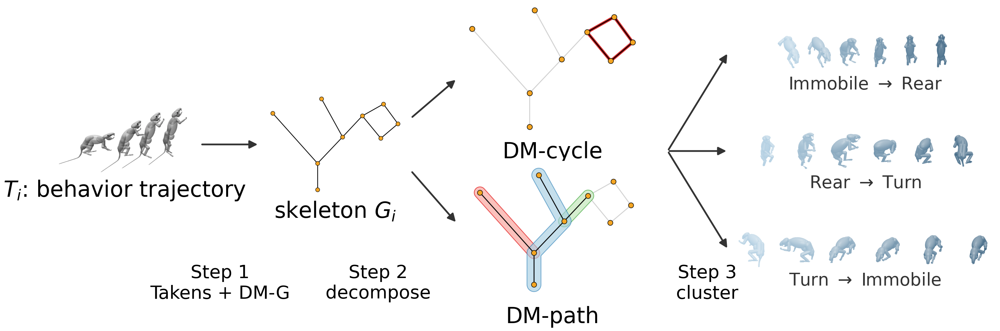
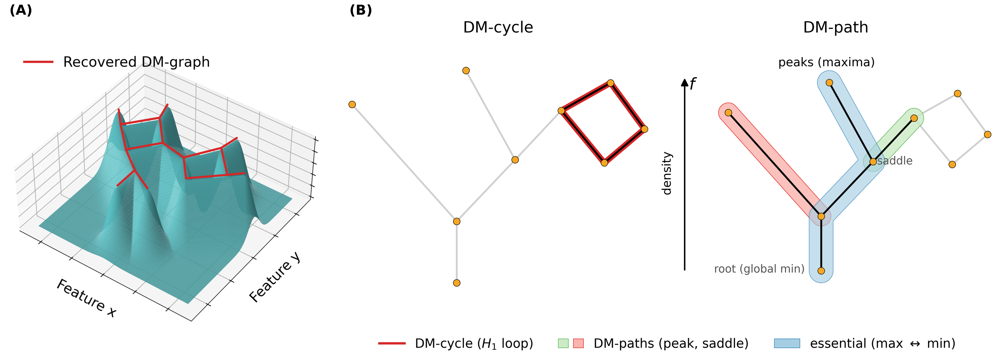

<div align="center">

# Shaped by What's Missing

### Topological Invariance Simplification Discovers Behavioral Transitions

Kaiwen Bian<sup>1,2</sup> &nbsp;·&nbsp;
Eric J. Leonardis<sup>2</sup> &nbsp;·&nbsp;
Yuanjia Yang<sup>1,2</sup> &nbsp;·&nbsp;
Charles Zhang<sup>3</sup> &nbsp;·&nbsp;
Yusu Wang<sup>1</sup> &nbsp;·&nbsp;
Talmo D. Pereira<sup>2</sup>

<sup>1</sup>University of California San Diego &nbsp;&nbsp;
<sup>2</sup>Salk Institute for Biological Studies &nbsp;&nbsp;
<sup>3</sup>Harvard University

**NeurIPS 2026 Workshop on Symmetry and Geometry in Neural Representations (NeurReps), Proceedings Track**

[](https://kbian.org/TopoMimic-website/)
[](https://www.neurreps.org/)
[](https://mimic-mjx.talmolab.org/)
[](LICENSE)
[](https://www.python.org/)



</div>

---

## TL;DR

Most behavior-segmentation methods partition time into discrete states first and treat transitions as whatever lies between them. We take the opposite view. In a suitable feature space, sustained behaviors are **dense regions** of a trajectory's density landscape and transitions are the **sparse corridors and loops** that connect them, so transitions can be read off the landscape's shape with topology, without any upstream state partition.

We reconstruct each trajectory's **discrete-Morse graph** and decompose it into two primitives: **DM-paths**, the corridors a trajectory follows between dense behavioral regions, and **DM-cycles**, closed routes whose entry and exit take different ways. Clustering these primitives under the 2-Wasserstein distance yields behavioral transitions directly. On a rat behavior dataset in three feature spaces, including the latent space of a deep-RL controller that imitates the animal in a physics simulator ([MIMIC-MJX](https://mimic-mjx.talmolab.org/)), this recovers transitions at coverage comparable to Keypoint-MoSeq and Mapper while carrying substantially more information about transition identity.

## Highlights

| | DM primitives (ours) | Best baseline |
|---|---|---|
| Transition information $I(T;Y)$ | **0.90 bits** (DMP-Qpos), 0.87 (DMC-Int) | 0.53 (Keypoint-MoSeq), 0.32 (Mapper) |
| Cardinality-corrected AMI | **0.23** | 0.16 |
| Lower DTW warping fraction | **9 of 11** transitions | Keypoint-MoSeq leads on none |
| Mean DTW to annotated boundaries | **0.792 / 0.815** | 0.822 (Mapper), 0.851 (Keypoint-MoSeq) |
| Directed transitions discovered | 10 of 16 | 11 (Mapper), 9 (Keypoint-MoSeq) |

Numbers are from Table 1, Table 8 and §5 of the paper. The same corridors and loops appear in all three feature spaces: egocentric keypoints, joint angles, and the controller's latent intention.

## Method

<div align="center">

</div>

1. **Skeletonize.** Each trajectory is Takens-embedded so every point carries a short window of motion, and the discrete-Morse graph reconstruction of [Magee & Wang (2022)](https://doi.org/10.20382/jocg.v13i1a16) recovers the ridges of its k-NN density field as a 1-D skeleton *G*.
2. **Decompose.** A filtration-weighted minimum cycle basis of *G* gives the **DM-cycles** (H₁ loops). The remaining split tree, ordered by density, gives the **DM-paths** as peak-to-saddle corridors plus the essential global-max-to-global-min path.
3. **Cluster.** Primitives are compared as empirical distributions under exact 2-Wasserstein distance, embedded with metric MDS, and clustered with K-means (DM-WKC). Baselines share the same evaluation; ground-truth labels are used only for evaluation.

## Installation

**Requirements:** Linux, Python 3.12, `g++` (C++11), and a CUDA GPU for the Keypoint-MoSeq baselines and MuJoCo rendering (the DM pipeline itself runs on CPU).

**1. Clone the repository.**

```bash
git clone https://github.com/KevinBian107/TopoMIMIC.git
cd TopoMIMIC
```

**2. Install the MIMIC-MJX stack.** JAX, MuJoCo and MuJoCo-MJX come from [track-mjx](https://github.com/talmolab/track-mjx). Follow its installation guide (the `uv` route with the extra matching your CUDA version), then activate that environment.

**3. Install the analysis dependencies** (pinned to the versions used for the paper):

```bash
pip install -r requirements.txt
```

**4. Build the discrete-Morse backend.** We use the reference implementation [PCD-Graph-Recon-DM](https://github.com/lucasjmagee/PCD-Graph-Recon-DM) (tested at commit `711c58e`), cloned into the repository root:

```bash
git clone https://github.com/lucasjmagee/PCD-Graph-Recon-DM.git
cd PCD-Graph-Recon-DM/dmpcd/code/persistence_swr && g++ DiMoSC.cpp -I./phat/include -std=c++11 -o spt_cpp
cd ../phat_morse_src && g++ ComputeGraphReconstruction.cpp
cd ../../../..
```

This produces `dmpcd/code/persistence_swr/spt_cpp` and `dmpcd/code/phat_morse_src/a.out`. To keep the backend elsewhere, set `DMPCD_ROOT=/path/to/PCD-Graph-Recon-DM`.

**5. Verify.** The snippet reconstructs the skeleton of a noisy circle and should report one loop:

```bash
python -c "
import numpy as np
from topo_mimic.extraction.skeletonization.skeletonization import extract_skeleton_pcd_dm, extract_all_cycles
t = np.linspace(0, 2 * np.pi, 300)
pts = np.c_[np.cos(t), np.sin(t)] + 0.03 * np.random.default_rng(0).normal(size=(300, 2))
_, G = extract_skeleton_pcd_dm(pts, k=5, pers_delta=0.1)
print('loops:', len(extract_all_cycles(G)))
"
```

## Data

| File | Contents | Source | Location |
|---|---|---|---|
| `rodent_ar.h5` | Rollouts of the MIMIC-MJX rat imitation policy: latent intention and joint angles for 842 clips | [Google Drive](https://drive.google.com/file/d/1exMwbJbJAqhJdKvT6ez9POY-bFGYbemN/view?usp=sharing) | `data/rodent_ar.h5` |
| `rodent_reference_clips.h5` | Reference clips used to compute egocentric keypoints | [Hugging Face](https://huggingface.co/datasets/talmolab/MIMIC-MJX) | `data/rodent_reference_clips.h5` |
| `rodent_labels.csv` | Proofread behavior and turn-direction labels (evaluation only) | included | `behavior_labels/rodent_labels.csv` |

```bash
mkdir -p data
python -c "from huggingface_hub import hf_hub_download; hf_hub_download(repo_id='talmolab/MIMIC-MJX', repo_type='dataset', filename='data/rodent/rodent_reference_clips.h5', local_dir='.')"
mv data/rodent/rodent_reference_clips.h5 data/ && rmdir data/rodent
```

The labels were produced with our heuristic auto-labeling pipeline and proofread by two annotators; the annotation tool is [TopoMimic-annotation](https://github.com/KevinBian107/TopoMimic-annotation).

## Quick start

Every stage is driven by a YAML config under `configs/` and a shell script under `bash_scripts/`. Run from the repository root:

```bash
bash bash_scripts/run_all.sh                # everything below, in order
```

| Stage | Command | What it does |
|---|---|---|
| Extraction | `bash bash_scripts/run_extraction.sh` | Takens embedding, DM skeleton, DM-cycles and DM-paths for intention, qpos and ekp |
| Benchmark | `bash bash_scripts/run_experiment.sh` | W2 → MDS → K-means for the six DM variants, Keypoint-MoSeq, Mapper, and the full-clip control (3 seeds) |
| Evaluation | `bash bash_scripts/run_feature_analysis.sh` | Cluster labeling, DTW alignment, consistency, warping decomposition, KID |
| Method analyses | `bash bash_scripts/run_method_analysis.sh` | Information-theoretic analysis, behavioral asymmetry, stationary-clip study |
| Baseline sweep | `bash bash_scripts/run_scale_sweep.sh` | 110-variant Keypoint-MoSeq and Mapper sweep and its rescoring |
| Sensitivity | `bash bash_scripts/run_sensitivity.sh` | MDS dimension, k-neighbor, path persistence, skeleton reduction |
| Tables | `bash bash_scripts/run_tables.sh` | Writes every paper table to `paper/bian_NeurReps_2026/tables/` |
| Figures | `bash bash_scripts/run_figures.sh` | Renders the appendix figures (needs a MuJoCo GL backend) |

Set `PYTHON=/path/to/python` to choose the interpreter used by the drivers. Rendering uses MuJoCo with `MUJOCO_GL=egl` on GPU nodes; `osmesa` works for CPU-only machines.

## Repository structure

```
TopoMIMIC/
├── topo_mimic/
│   ├── extraction/          # Takens embedding, DM skeleton, DM-cycles and DM-paths
│   ├── experiment/          # W2 → MDS → K-means benchmark, Keypoint-MoSeq and Mapper baselines
│   ├── analysis/
│   │   ├── feature_analysis/    # labeling, DTW, consistency, warping, KID
│   │   ├── method_analysis/     # information loss, asymmetry, sweeps, stationary clips
│   │   ├── mapper/              # Mapper baseline
│   │   └── scale_sweep/         # baseline hyperparameter sweep and rescoring
│   ├── figure_generation/   # paper tables and figures
│   └── labeling/            # auto-labeling and annotation rendering
├── configs/                 # YAML configs, mirroring topo_mimic/
├── bash_scripts/            # stage drivers
├── behavior_labels/         # proofread ground-truth labels
├── demos/                   # illustrative demos
└── docs/                    # documentation and figures
```

More detail: [reproducing every table and figure](docs/reproducing.md), [running the pipeline](docs/running.md), [codebase structure](docs/codebase_structure.md), [demos](docs/demos.md), [transition mapping](docs/transition_mapping.md).

## Citation

```bibtex
@inproceedings{bian2026shaped,
  title     = {Shaped by What's Missing: Topological Invariance Simplification Discovers Behavioral Transitions},
  author    = {Bian, Kaiwen and Leonardis, Eric J. and Yang, Yuanjia and Zhang, Charles and Wang, Yusu and Pereira, Talmo D.},
  booktitle = {Proceedings of the NeurIPS Workshop on Symmetry and Geometry in Neural Representations (NeurReps)},
  series    = {Proceedings of Machine Learning Research},
  year      = {2026}
}
```

## Acknowledgements

The trajectories come from [MIMIC-MJX](https://mimic-mjx.talmolab.org/) ([track-mjx](https://github.com/talmolab/track-mjx), [stac-mjx](https://github.com/talmolab/stac-mjx)). The discrete-Morse graph reconstruction uses [PCD-Graph-Recon-DM](https://github.com/lucasjmagee/PCD-Graph-Recon-DM). Baselines use [Keypoint-MoSeq](https://github.com/dattalab/keypoint-moseq) and [tda-mapper](https://github.com/lucasimi/tda-mapper-python).

## License

Released under the [BSD 3-Clause License](LICENSE). The Keypoint-MoSeq baseline dependencies (`keypoint-moseq`, `jax-moseq`) are distributed by Harvard under their own non-commercial academic license, and PCD-Graph-Recon-DM is obtained from its upstream repository under its authors' terms.
