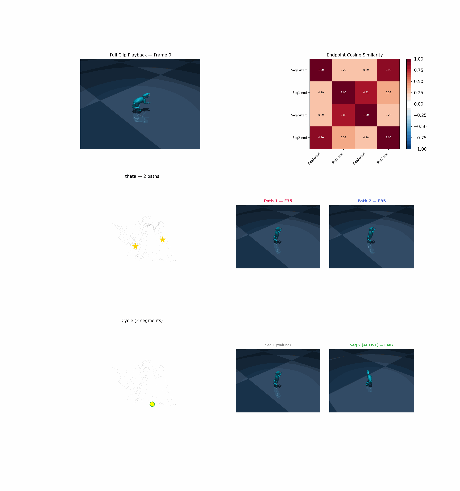

# Intuition: DM Paths, Cycles, and Transition Topology

## The Core Idea

We analyze the latent space of a locomotion policy by treating it as a **density landscape**. Each timestep of a rollout is a point in feature space (intention embeddings, joint angles, or egocentric keypoints). After Takens time-delay embedding, these points form a cloud in high-dimensional space. The shape of this cloud — where it's dense, where it's sparse, and how the dense regions connect — reveals the behavioral structure of the policy.

Discrete Morse theory gives us a principled way to extract this structure: a **skeleton graph** that compresses the point cloud down to its essential topology while preserving the connectivity between density basins.

## The Density Landscape

The first step is assigning each point a **density weight**: the RMS distance to its k nearest neighbors. Low weight means dense neighborhood (many similar poses nearby), high weight means sparse (unusual or transitional pose).

Think of this as an inverted terrain — density peaks become valleys (low weight), and sparse transition regions become ridges (high weight):

```
Weight (low = dense)
  ↑
  |          saddle (pass)
  |      ------·------
  |     /       \      \
  |    /  Basin A \  Basin B
  |   /  (rearing) \ (walking)
  |  ·               ·
  |  min₁            min₂
  +---------------------------→ feature space
```

**Basin A** and **Basin B** are where the rodent spends most of its time — stable behavioral modes. The saddle between them is the transition region where behavior switches.

## Persistence: Separating Signal from Noise

Not every bump in the density landscape is meaningful. Persistent homology quantifies how significant each basin is through **persistence pairs**.

A type-0 (min-saddle) persistence pair records:
- **Birth**: a density peak appears as a new connected component at filtration value `α_birth = weight(vertex)`
- **Death**: the component merges into an older one when the saddle edge enters at `α_death = weight(edge)`
- **Persistence** = `α_death − α_birth`

High persistence means a deep, well-separated basin — a genuinely distinct behavioral mode. Low persistence means a shallow bump — noise or an insignificant sub-state.

We rank all type-0 pairs by persistence and take the **top two**. These are the two most topologically significant density minima: the two dominant behavioral states in the clip.

## The DM Path: The Primary Transition Recovery Tool

The discrete Morse skeleton is a graph that threads through the point cloud, connecting critical points via descending manifold paths. The two density minima live in this graph, and we can find the **shortest path** between them — the DM path.

The DM path is the **primary tool for detecting behavioral transitions**. Because it connects the two deepest density basins via the skeleton, it naturally threads through the transition region — the saddle where behavior switches. It captures the sequence of poses the rodent traverses when switching from one behavioral mode to another.

This works reliably because:
- The minima are identified by persistence (topologically principled, not heuristic)
- The skeleton preserves connectivity (the path follows the manifold's own structure)
- The path follows the densest route through the transition zone (well-sampled, gradual trajectory)

The DM path answers the question: **what does the transition between two behavioral modes look like?**



## Cycles: Detecting Behavioral Asymmetry

Cycles in the DM graph are extracted independently of the DM path — they come from a purely graph-theoretic algorithm (fundamental cycles via MST + non-tree edges). Cycles and DM paths operate on the same graph but are computed by completely different methods with no awareness of each other.

While the DM path reliably captures transitions, cycles provide a **deeper layer of insight** when they meet certain conditions. A well-formed cycle reveals something the DM path alone cannot: whether the transition into a behavior is **different from the transition out**.

### Cycles as the Cherry on the Cake

Not every cycle is informative. Many cycles in the DM graph are topological artifacts — they close via a few sparse bridge edges that jump across the point cloud without tracing a real behavioral trajectory. A cycle is only meaningful when it satisfies specific conditions.

### The Path Endpoint Matching Condition

The critical condition for a behaviorally meaningful cycle is **path endpoint matching**: the start of one edge-disjoint path must coincide with the end of another.

**Two-path case (theta-graph)**:

```
        Path 1: A ──────→ B
       ╭──────────────────╮
  min₁ ·                  · min₂
       ╰──────────────────╯
        Path 2: B ──────→ A
```

Path 1 starts near behavioral state A and arrives at state B. Path 2 starts near state B and returns to state A. The endpoint matching means:
- The end of Path 1 ≈ the start of Path 2 (both at state B)
- The end of Path 2 ≈ the start of Path 1 (both at state A)

When this holds, the two paths form a **closed behavioral loop**: the rodent leaves state A one way and returns a different way. This is **behavioral asymmetry** — the motor program for entering a behavior is distinct from the motor program for exiting it.

**Three-or-more-path case (higher connectivity)**:

The same principle generalizes. With k edge-disjoint paths between min₁ and min₂, endpoint matching requires that the paths chain together — each path's endpoint is close to another path's startpoint — forming a closed traversal through all k distinct routes:

```
        Path 1: A ──→ B
       ╭──────────────╮
  min₁ ·───────────────· min₂
       │    Path 2: B ──→ C
       ╰──────────────╯
        Path 3: C ──→ A
```

Higher edge connectivity with endpoint matching reveals **multi-phase asymmetry**: the transition between two behavioral modes involves k distinct motor programs, each used for a different phase of the transition sequence.

### Why Cycles Can Miss Transitions

Unlike the DM path, which is guided by density minima and follows the densest route, the cycle algorithm has no concept of behavioral relevance. A fundamental cycle is just any closed loop in the graph. In practice, this means:

- The cycle may follow the main transition for one leg (same route as the DM path) but close via a **sparse bridge** — a handful of scattered points that happen to create a graph shortcut. These bridge points don't represent a real return trajectory.
- The cycle may **miss intermediate transition frames** that the DM path captures, because the cycle's route through the graph takes a different branch than the one threading through the transition zone.
- The DM path captures transitions that cycles miss entirely, especially when the return trajectory is fast (few samples) or geometrically similar to the forward trajectory (skeleton merges them into one branch).

This is why the DM path is the primary transition recovery tool and cycles are a secondary, conditional signal.

### When a Cycle Is Behaviorally Meaningful

A cycle indicates genuine behavioral asymmetry when **all** of the following hold:

1. **Edge connectivity ≥ 2** — at least two edge-disjoint paths exist between the minima, forming a theta-graph or higher structure
2. **Path endpoint matching** — the start of each path is close (in intention space) to the end of another path, confirming the paths chain into a closed behavioral loop
3. **Dense paths** — both (or all) paths have comparable length and sample density, ruling out sparse bridge artifacts
4. **Temporal coherence** — the cycle segments, when mapped back to clip frames, correspond to interpretable behavioral phases with smooth transitions

When all conditions hold, the cycle captures a complete **behavioral primitive with asymmetric transitions**.

### What Behavioral Asymmetry Tells Us

A clean cycle with endpoint-matched paths is a strong claim: the rodent does not simply reverse its motion when switching between behaviors. The forward and return transitions occupy **geometrically distinct regions** of the feature space — they are different motor programs.

Consider a rear-walk-rear sequence. A symmetric transition would mean the rodent lowers itself into walking the same way it raises itself back up, just played in reverse. The DM path would capture this as a single route traversed in both directions, and no cycle would form (λ = 1).

An asymmetric transition means the lowering and raising use different joint coordination patterns. Perhaps the rodent crouches forward and extends its forelimbs to initiate walking (Path 1), but gathers its hindlimbs and pushes upward to return to rearing (Path 2). These two trajectories trace different curves through joint-angle space, and the DM skeleton preserves them as separate branches — giving λ ≥ 2 and a clean cycle.

This distinction matters for motor control:

- **Symmetric transitions** suggest a single reversible motor primitive that can be run forward or backward. The control policy has learned one pathway between states.
- **Asymmetric transitions** suggest the policy has learned **distinct motor primitives** for entering and exiting a behavior — separate control strategies tuned to the biomechanical demands of each direction. Going downhill is not the reverse of going uphill.

The degree of asymmetry (how different the paths are in feature space, how dissimilar the cross-path endpoints are in intention space) quantifies how distinct these motor programs are. A barely asymmetric cycle (paths close together, moderate endpoint dissimilarity) suggests the two programs are variations of each other. A strongly asymmetric cycle (paths far apart, low cross-mode cosine similarity) suggests fundamentally different control strategies.

With three or more edge-disjoint paths, the asymmetry becomes **multi-phase**: the transition between two behaviors involves multiple distinct motor strategies, potentially corresponding to different biomechanical solutions (e.g., fast vs. slow transitions, left-biased vs. right-biased weight shifts). Each additional path is an additional motor program the policy deploys for the same behavioral transition.

## Endpoint Similarity: Validating the Topology

As a consistency check, we compute the **intention-space similarity** of segment endpoints. For a cycle with k paths, endpoint matching should produce a characteristic pattern in the cosine similarity matrix:

- **Matching endpoints** (end of Path i ≈ start of Path j): high cosine similarity — both represent the same behavioral state
- **Cross-mode endpoints** (state A vs. state B): low cosine similarity — distinct behavioral modes should be dissimilar
- **Self-diagonal**: trivially 1.0

This cross-referencing between the DM topology (computed in whatever feature space) and the intention space (the policy's own latent representation) validates that the topological structure corresponds to interpretable behavioral transitions, and that the endpoint matching condition holds.

## Summary

```
Point Cloud (Takens-embedded rollout)
        │
        ▼
Density Weights (k-NN RMS)
        │
        ▼
Persistence Pairs (sublevel-set filtration)
        │
        ├─ Rank by persistence
        ├─ Top 2 = dominant behavioral basins
        │
        ▼
DM Skeleton Graph
        │
        ├─── DM Path (primary) ──────────────────────────────────────────╮
        │    Shortest path between min₁ and min₂                        │
        │    → Captures the main behavioral transition reliably          │
        │                                                                │
        ├─── Edge-Disjoint Paths + Cycles (secondary) ──────────────────┤
        │    λ = edge connectivity between min₁ and min₂                │
        │                                                                │
        │    λ = 1 → Single transition route                             │
        │            DM path tells the full story                        │
        │                                                                │
        │    λ ≥ 2 → Multiple routes exist                               │
        │            Check endpoint matching condition:                   │
        │                                                                │
        │            ✓ Endpoints match + dense paths                     │
        │              → Behavioral asymmetry detected                   │
        │              → Entering ≠ exiting motor programs               │
        │                                                                │
        │            ✗ Endpoints don't match / sparse bridges            │
        │              → Cycle is a topological artifact                 │
        │              → Fall back to DM path interpretation             │
        │                                                                │
        ▼                                                                │
Endpoint Similarity Validation ←─────────────────────────────────────────╯
  Cosine similarity in intention space confirms
  whether path endpoints chain into a closed behavioral loop
```

The DM path is the workhorse — it reliably detects what the transition between two behavioral modes looks like. Cycles, when they satisfy the endpoint matching condition, reveal something deeper: that the transition is **asymmetric**, with distinct motor programs for entering and exiting a behavior. The combination of DM path (always available) and validated cycles (conditionally available) gives a complete picture of transition topology in the behavioral manifold.
