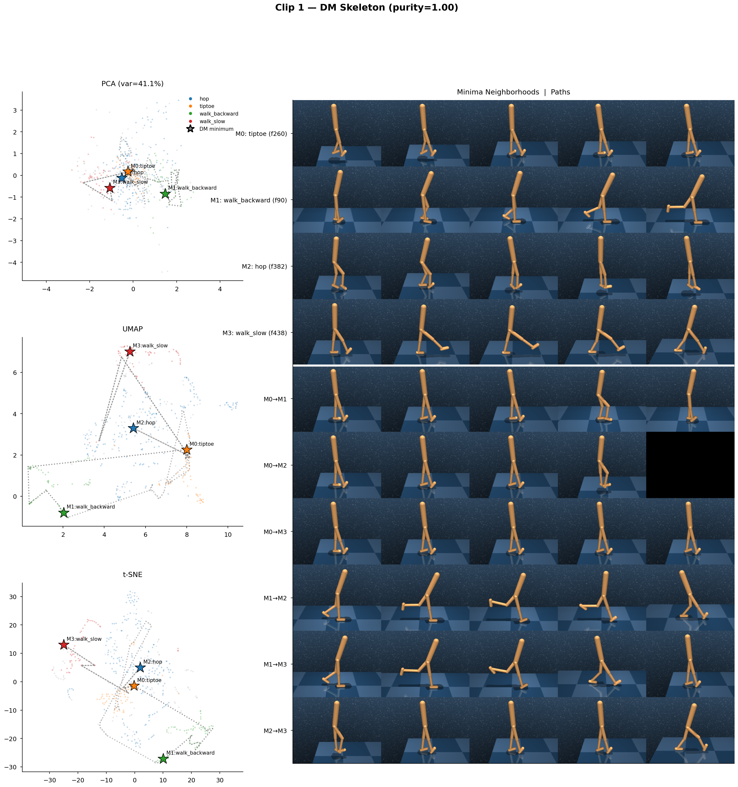

# Walker Demo: Skeleton Analysis

The skeleton analysis extracts a **behavioral state machine** from DM (Discrete Morse) graph output. It identifies stable behavioral modes as graph minima, connects them via topological paths, and visualizes the result against dimensionality-reduced projections and MuJoCo-rendered pose sequences.

This document traces the exact algorithmic pipeline, from raw intention features to the final combined figure.

## Pipeline Overview

```
intention features (T × 16)
        ↓
Takens embedding (T' × 16m)     ← delay embedding, m windows of tau-spaced copies
        ↓
Sparse weighted Rips filtration  ← k-NN graph + distance-based weights
        ↓
Persistent homology (PHAT)       ← persistence pairs with birth/death
        ↓
Graph reconstruction (DiMoSC)    ← Morse-Smale complex at pers_delta threshold
        ↓
Skeleton extraction              ← behavior-diverse minima selection + path finding
        ↓
Combined visualization           ← PCA/UMAP/t-SNE + minima grid + paths grid
```

## Step 1: DM Graph Construction

The DM graph `G_sm` is built by `extract_skeleton_pcd_dm` in `topo_mimic/dmwk/skeletonization/skeletonization.py`. The inputs are Takens-embedded intention features (not raw frames).

### 1a. Sparse Weighted Rips Filtration

`pcd.build_sparse_weighted_rips_filtration(features.txt, output_dir, k, metric='euclidean', epsilon)` builds a neighborhood graph:

- **k** (`k_neighbors` in config, default 8): number of nearest neighbors per point. This controls graph density. Too low → disconnected components. Too high → over-connected, losing topological detail.
- **epsilon** (default 0.99): sparse Rips approximation parameter. Controls the trade-off between filtration fidelity and computation cost.
- **metric**: Euclidean distance in the Takens-embedded space.

Output: `sparse_weighted_rips_filtration.txt` — a simplicial filtration where each line is a simplex (dimension, vertex indices, filtration value). Vertices are re-indexed by weight-sorted order.

### 1b. Persistence Computation

`pcd.compute_persistence_swr` runs PHAT on the filtration, producing `edge_for_morse_only.txt`:

```
v0  v1  type  persistence
```

- **type 0** pairs: vertex-edge pairs. The two vertices `v0, v1` are linked by a persistence pair; the lower-weight vertex is a **minimum**, the higher is a **saddle** that cancels it.
- **persistence**: `|death - birth|`. Higher persistence = more topologically significant minimum.

### 1c. Graph Reconstruction

`pcd.compute_graph_reconstruction(sorted_weights, edges, pers_delta, output_dir)` runs the DiMoSC algorithm:

- **pers_delta** (default 0.3): persistence threshold. Pairs with persistence < pers_delta are cancelled (merged). Only minima surviving above this threshold appear as critical points in the reconstructed graph.
- Output: `dimo_edge.txt` — edge list of the Morse-Smale graph `G_sm`.

The graph `G_sm` is a NetworkX undirected graph where nodes are weight-sorted vertex indices and edges represent the Morse-Smale skeleton.

### 1d. Index Remapping

DM operates in a re-indexed space. Two mappings are needed:

1. **SWR remap** (`parse_swr_remap`): parses `sparse_weighted_rips_filtration.txt` to build `{weight_sorted_idx → original_takens_idx}`. Only dimension-0 simplices (vertices) are mapped.
2. **Takens to original**: Takens index `t` maps to original frame `t` (the first frame of the delay window). Indices ≥ `n_takens` are filtered out.

`remap_cycle_to_original(indices, remap, n_takens)` chains both: DM index → Takens index → bounds-checked original frame index.

## Step 2: Minima Selection (Behavior-Diverse)

`extract_skeleton_for_clip` selects minima that cover distinct behaviors rather than just the most persistent ones.

### 2a. Candidate Pool

```python
candidate_pool = _find_all_persistent_minima(clip_dir, top_k=max(n_desired * 5, 30))
```

`_find_all_persistent_minima` parses `edge_for_morse_only.txt`:

1. Filter to type-0 persistence pairs only (vertex-edge cancellations).
2. Sort by `|persistence|` descending.
3. For each pair `(v0, v1)`: the vertex with lower weight (`sorted-weights.txt`) is the minimum; the other is its paired saddle.
4. Deduplicate: each minimum vertex appears at most once.
5. Return up to `top_k` minima, ordered by persistence.

The pool requests 5× the desired count (minimum 30) to ensure behavioral coverage.

### 2b. Remap and Label

Each candidate minimum (a DM graph index) is remapped to an original frame index via `remap_cycle_to_original([m], remap, n_takens)`. The GT behavior label at that frame is looked up from `frame_labels`.

### 2c. Greedy Behavior-Diverse Selection

The desired number of minima `n_desired` equals the number of distinct GT behaviors in the clip (excluding "transition"). Selection proceeds in two passes:

1. **Coverage pass**: iterate candidates in persistence order. For each candidate whose behavior hasn't been seen yet, select it and mark the behavior as covered. This guarantees the most persistent representative per behavior.
2. **Fill pass**: if fewer than `n_desired` selected, add remaining candidates in persistence order regardless of behavior.

This prevents the failure mode where all top-k minima cluster in one dominant behavior region.

### 2d. Purity Metric

```python
purity = |unique_non_transition_behaviors| / |selected_minima|
```

Purity = 1.0 means every minimum maps to a different behavior. Purity < 1.0 means some behaviors share minima or a minimum landed in a transition region.

## Step 3: Path Extraction

For every pair of selected minima `(m_a, m_b)`:

```python
raw_paths = list(nx.edge_disjoint_paths(G_sm, m_a, m_b))
```

- **Edge-disjoint paths**: NetworkX computes the maximum set of paths between two nodes that share no edges (Menger's theorem via max-flow). This gives topologically distinct routes through the skeleton.
- **k_paths** (default 1): how many edge-disjoint paths to keep per pair.
- Each path is remapped to original frame indices. Paths with fewer than 3 valid frames are discarded.

These paths represent the DM skeleton's "transition routes" between behavioral modes — the topological corridors the manifold provides between stable states.

## Step 4: Fréchet Distance Comparison

`discrete_frechet_distance(P, Q)` computes the discrete Fréchet distance between two curves in UMAP space using standard O(nm) dynamic programming:

```
ca[i,j] = max(min(ca[i-1,j], ca[i,j-1], ca[i-1,j-1]), ||P[i] - Q[j]||)
```

For each DM path between minima, three curves are compared:

1. **DM path curve**: UMAP coordinates of path frames in DM traversal order.
2. **Temporal curve**: same frames sorted by time (the actual trajectory the walker took).
3. **Straight-line baseline**: linear interpolation between the two minima centroids in UMAP space.

The Fréchet distance measures how well the DM path captures the geometric shape of the actual temporal trajectory, compared to a naive straight line. Lower DM Fréchet distance (relative to baseline) indicates the DM skeleton follows the manifold's actual geometry.

## Sample Output



Clip 1 with 4 behaviors (hop, tiptoe, walk_backward, walk_slow). Left column: PCA/UMAP/t-SNE with skeleton overlay — each star is a DM minimum landing in a distinct behavior cluster, connected by grey dotted DM paths. Right column: top section shows MuJoCo-rendered neighborhoods around each minimum (rows M0–M3), bottom section shows rendered frames along each DM path between minima pairs (M0→M1, M0→M2, etc.). Purity = 1.00 indicates all 4 minima map to distinct behaviors.

## Step 5: Combined Visualization

`plot_skeleton_combined` produces a single figure per clip: `clip_{id}_skeleton.png`.

### Left Column (3 rows): Dimensionality Reduction with Skeleton Overlay

Each row shows PCA, UMAP, or t-SNE of the raw intention features:

- **Background**: all frames as small dots, colored by GT behavior label, low alpha.
- **Minima**: large star markers at the frame each minimum maps to, colored by behavior, with black edge. Labeled `M{k}:{behavior}`.
- **Paths**: grey dotted lines connecting frames along each DM path in embedding space.
- **Legend**: on PCA panel only.
- Aspect ratio is set to `equal` on all embedding axes.

### Right Column (stacked): Rendered Grids

The right column spans the full height of the left column. It contains two vertically stacked grids separated by a white line:

**Top — Minima Neighborhoods**: rows = minima, columns = `minima_n_frames` (default 5) evenly-spaced frames from a `±minima_frame_radius` (default 10) window around the minimum's frame. Row labels: `M{k}: {behavior} (f{frame})`.

**Bottom — Path Samples**: rows = paths (one per connected minima pair), columns = evenly-sampled frames along the path. Row labels: `M{i}→M{j}`.

Both grids are rendered via MuJoCo (`mujoco.Renderer`, camera="side") at `target_size` resolution.

### Separate File: Path Geometry

`clip_{id}_path_geometry.png` shows per-path Fréchet analysis with UMAP curves overlaid (DM path in blue, temporal in red dashed, straight baseline in black dotted) and a summary bar chart.

## Configuration

```yaml
skeleton_analysis:
  enabled: true
  n_minima: 8              # fallback if no GT labels; overridden by behavior count
  k_paths: 1               # edge-disjoint paths to keep per minima pair
  umap_n_neighbors: 15     # UMAP neighborhood size
  umap_min_dist: 0.1       # UMAP minimum distance
  render_minima: true       # render MuJoCo grids
  minima_n_frames: 5        # columns in rendered grids
  minima_frame_radius: 10   # neighborhood radius for minima sampling
  frechet_enabled: true     # compute Fréchet distance comparison
  target_size: [320, 240]   # MuJoCo render resolution [w, h]
```

## Key Files

| File | Role |
|------|------|
| `demos/transition_demos/demo_walker_transitions_path.py` | Skeleton analysis implementation (extraction, plotting, orchestration) |
| `topo_mimic/dmwk/skeletonization/skeletonization.py` | `extract_skeleton_pcd_dm` — builds DM graph from point cloud |
| `topo_mimic/dmwk/skeletonization/dm_path.py` | `_parse_persistence_pairs`, `_parse_sorted_weights` — reads DM output files |
| `topo_mimic/dmwk/skeletonization/remap.py` | `parse_swr_remap`, `remap_cycle_to_original` — index space conversion |
| `configs/demos/transition_demos/demo_walker_transitions_path.yaml` | Configuration including `skeleton_analysis:` section |
